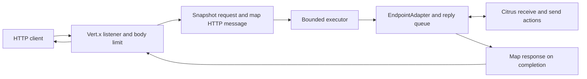

# Architecture: Evaluate Vert.x for the Citrus HTTP server

## Status and decision

**Stage 02, 2026-10-13.** [Stage 01](01-specification.md) passed its planning gate before this
document was started. Recommend **Approach C: a test-only Vert.x endpoint prototype alongside
the current Jetty server**, followed by an evidence-based migration decision. This selects an
evaluation architecture, not a production replacement. All future evaluation execution uses
**JDK 21 only**; the repository's Java 17 source/release target stays unchanged. No executable
work is performed here.

## Research: existing patterns

Repository paths are relative to the root at `f821ff802842ecb9969261352587d8c754b35c72`.

| Component | Finding and architectural consequence |
|---|---|
| `core/citrus-base/.../base/server/AbstractServer.java` | Owns initialization, adapter, receive/send delegation and start/stop hooks. Reuse this endpoint boundary. Its `destroy()` calls `shutdown()` directly while running, so the prototype must explicitly make cleanup idempotent and running-state handling consistent. |
| `core/citrus-base/.../endpoint/direct/DirectEndpointAdapter.java` | Calls a synchronous producer and waits for the test response. The transport handler cannot invoke it on a Vert.x event loop. |
| `core/citrus-base/.../endpoint/direct/DirectSyncProducer.java` and `DirectSyncConsumer.java` | Use temporary reply queues and correlation keys, including test-context state. Preserve these mechanisms. Reverse-order replies need separate test contexts or explicit correlation selection; a shared mutable test context is not proof of transport correctness. |
| `endpoints/citrus-http/.../http/actions/HttpActionBuilder.java` | `server(Endpoint)` permits a different server implementation to use existing HTTP actions without inheriting the Jetty-specific `HttpServer`. |
| HTTP `HttpMessageController`, `HttpMessageConverter` and `DelegatingHttpEntityMessageConverter` | Separate Servlet metadata extraction, Citrus header/entity mapping, and body conversion. The prototype can reuse entity/header conversion but must replace Servlet request access and explicitly implement wire-body conversion. |
| HTTP `HttpServer`, `AbstractHttpServerBuilder`, `HttpServerConfig`, parsers, schemas and builder registrations | Expose Jetty connectors/handlers, Servlet filters and Spring MVC interceptors. An engine swap is an API/configuration migration, not a private implementation change. |
| `endpoints/citrus-vertx` | Implements event-bus messaging, with optional clustered instance factories. Do not import that module or its Hazelcast lifecycle just to create an HTTP listener. |
| Root `pom.xml` | Manages Vert.x 4.5.31 and Jetty 12.1.11, targets Java 17, configures Surefire/Failsafe with TestNG. Pin experiments to this dependency baseline. |
| `AGENTS.md`, `CONTRIBUTING.md`, `.github/workflows/build.yml` | Use `./mvnw`, tests first, Apache headers, existing module conventions and integration verification before pushing. CI provisions JDK 17/21; Markdown-only changes are excluded from its main build trigger. |

Here `...` abbreviates `src/main/java/org/citrusframework` only. The specification contains
fully expanded paths for the principal source files.

The version-pinned upstream API confirms non-clustered instance creation and asynchronous HTTP
binding/closing with an actual bound-port accessor. Vert.x also documents that lengthy blocking
operations belong on application-managed threads; ordered blocking dispatch serializes work
from the same context. These support the proposed lifecycle and executor choices, not a claim
that Citrus compatibility has been demonstrated.
Sources: [Vert.x 4.5.31 core API](https://raw.githubusercontent.com/eclipse-vertx/vert.x/4.5.31/src/main/java/io/vertx/core/Vertx.java),
[HTTP server API](https://raw.githubusercontent.com/eclipse-vertx/vert.x/4.5.31/src/main/java/io/vertx/core/http/HttpServer.java).

## Approach A: Replace the current HTTP implementation in place

**Description:** Keep the `HttpServer` identity and rebuild its internals around Vert.x.

**Changes:** HTTP lifecycle, controller/Servlet pipeline, conversion, builder/configuration
parsers, tests and manual; changes or compatibility shims for WebSocket and affected integrations.
SOAP retains its own Jetty stack unless separately migrated. No persistent data migration.

**Pros:** A successful final design could centralize the HTTP engine and make a later WebSocket
implementation share it. Fewer long-lived alternative server implementations.

**Cons:** Existing Jetty-typed signatures cannot acquire equivalent Vert.x semantics through an
internal substitution. Arbitrary Servlet handlers, filters and Spring MVC contexts have no
defined adapter in this plan. Keeping their signatures alone would not preserve behavior.
Changing superclass hooks affects WebSocket immediately. Full Jetty removal remains impossible
while independent SOAP/Selenium dependencies persist.

**Complexity:** High. **Fit:** Poor for an exploratory issue; it commits to migration before the
compatibility evidence exists.

## Approach B: Introduce an engine abstraction with Jetty and Vert.x implementations

**Description:** Extract common request/reply behavior behind a transport interface, preserve
Jetty as the default, and add explicit engine selection.

**Changes:** New production SPI, common configuration model, two engine lifecycles, explicit
engine-specific options, selection in builders/parsers/metadata, broader test matrix and
documentation. A later artifact split would be needed to make either engine dependency optional.
No persistent data migration.

**Pros:** Incremental adoption; shared semantic tests; possible transition path for common HTTP
configuration while legacy users keep Jetty.

**Cons:** Requires durable decisions about public types and engine-specific options now. Hiding
Servlet incompatibilities behind a generic SPI does not resolve them. Both libraries remain in
the runtime unless packaging is redesigned, and maintaining two engines costs more. WebSocket
inheritance and `HttpServer`-typed Kubernetes/Knative APIs still need deliberate treatment.

**Complexity:** High. **Fit:** Plausible production follow-up after a successful evaluation;
premature as the first prototype.

## Approach C: Isolated prototype using the existing generic endpoint boundary

**Description:** Add a test-only `VertxHttpServerPrototype` extending `AbstractServer`, with its
own minimal options and wire mapping. Compare it with the existing `HttpServer` using the same
external requests and Citrus actions.

**Proposed changes for a later implementation:**

- Test support under `endpoints/citrus-http/src/test/java/org/citrusframework/http/prototype/`.
  Keep socket integration tests under the existing HTTP integration test package.
- Add `io.vertx:vertx-core` with **test scope** in `endpoints/citrus-http/pom.xml`, using the
  root-managed version. No `vertx-web`, `citrus-vertx`, clustering dependency, runtime dependency,
  production module or BOM entry is initially necessary.
- Create a small request/response mapper, an endpoint-owned bounded executor, lifecycle/resource
  tracking, shared fixtures and an experiment harness. Do not modify existing production types
  to accommodate the prototype.
- Store future test reports and raw measurements under the module's `target/` directory. A
  later implementation/documentation record summarizes those results. No persistent application
  data or migration is involved.

**Pros:** Exercises real Citrus orchestration with limited change scope. Leaves all existing
configuration routes available. Allows negative findings and a retain-Jetty conclusion without
shipping an unproven API. Distinguishes transport feasibility from configuration compatibility.

**Cons:** Does not prove a final public API, Servlet equivalence or a Jetty-free dependency graph.
Some conversion glue may be discarded. A later production design is still required.

**Complexity:** Medium. **Fit:** Strongest match for #1808's evaluation/prototype scope.

## Recommendation and production boundary

Choose **C**. Implement only enough test support to establish the contracts below and evaluate
AC1–AC10. If the evidence supports further work, consider B with an explicit configuration and
artifact strategy. A is justified only by an agreed breaking-change policy and a migration plan
for every affected integration. Retaining Jetty remains a valid final evaluation outcome.

The prototype must not be registered under the public `http` endpoint builder, Spring namespace,
annotation parser, XML/YAML schemas, endpoint catalog or Cucumber steps. Its class names and
options below are proposed test support contracts, not exported API promises.

## Dependency and consumer impact

This is the initial source-backed inventory. AC1 completes the mechanical search inventory and
AC7/AC9 provide runtime evidence; a source scan alone cannot establish dependency convergence.

| Area | Observed dependency | Treatment during evaluation and later implication |
|---|---|---|
| `endpoints/citrus-http` | Jetty/Servlet runtime and public configuration types; Spring MVC dispatch | Retain production implementation; prototype has independent options. Migration must cover body conversion, metadata, listeners and extension points. |
| `endpoints/citrus-websocket` | `WebSocketServer extends HttpServer`, overrides `configure(ServletContextHandler)` and dispatcher construction; Jetty client configuration/dependencies | Keep existing server/client. #1807 needs its own Vert.x handshake/frame/session design and must replace the inheritance hook; HTTP success does not validate WebSocket compatibility. |
| `endpoints/citrus-ws` | `WebServiceServer extends AbstractServer`; separate Jetty/Servlet lifecycle, Spring-WS dispatcher and Jetty security | Independently retains Jetty. Its `citrus-http` dependency is test-scoped; it is not a subclass migration. Run SOAP regressions, plan any future transport change separately. |
| `tools/cucumber-steps/citrus-cucumber-http` | `HttpServerSteps` builds Jetty `ServerConnector`, TLS factories and `SslContextFactory` | TLS step implementation needs migration even if step text remains stable. Preserve the current steps for the prototype. |
| `connectors/citrus-kubernetes`, `connectors/citrus-knative`, Knative Cucumber steps | Resolve, construct or accept concrete `HttpServer` values and use ports/actions | Generic `Endpoint` compatibility of HTTP actions does not make these typed APIs accept the prototype. Record signatures/type checks; keep them on Jetty. |
| `connectors/citrus-openapi`, HTTP/Knative Cucumber consumers, `catalog/citrus-endpoint-catalog` | HTTP actions, concrete endpoint creation or catalog bindings | Exercise representative regressions; any published alternative needs explicit factories/configuration exposure. |
| `connectors/citrus-selenium` | Explicit Jetty WebSocket/client support dependencies; HTTP dependency in tests | HTTP replacement alone does not remove these dependencies. Record runtime/client dependency purpose separately from test server use. |
| `connectors/citrus-agent-connector`, OpenAPI code generation, other test consumers | HTTP dependency or test server usage | Classify actual runtime/test paths; include impacted test suites when the dependency graph changes. |
| Root dependency management and `endpoints/citrus-vertx` | Managed Vert.x tied to Fabric8, existing event-bus/Netty consumers | Use managed version. Inspect mediated Netty/Vert.x artifacts when both engines share a JVM. Do not reuse clustered event-bus factories. |
| Local GraphQL planning artifacts | Capability spec delegates server transport to HTTP; code is not present in this checkout | Record as a future consumer from local docs, not an existing production module or a verified regression target. |

Reproduce the initial source inventory with repository searches such as:

```sh
rg -n 'org\.eclipse\.jetty|extends HttpServer|org\.citrusframework\.http\.server\.HttpServer' --glob '*.java'
rg -n 'jetty|<artifactId>citrus-http</artifactId>|vertx.version' --glob 'pom.xml'
```

Review resources and configuration references as well; generated and test-only hits must not
be mistaken for public runtime signatures.

## Prototype contracts

### Endpoint and execution ownership

The prototype is a generic Citrus server endpoint. `initialize()` prepares an adapter and
receive/reply queues; construction does not bind a socket. `createConsumer()` and
`createProducer()` delegate to that adapter as existing `AbstractServer` does. Existing HTTP
receive/send actions operate on the prototype through `Endpoint`, using `HttpMessage` and
existing HTTP header names. No endpoint-interface changes are required.



Capture method, URI/path, headers, protocol, context path and a bounded body before dispatch.
Run `EndpointAdapter.handleMessage` on an **endpoint-owned Java executor**, never on the event
loop. A default of eight worker threads with total admission limited to 32 exchanges gives a
concrete initial experiment configuration; both are adjustable test options. Return completion
to the request's Vert.x context before writing the response. No Servlet thread-local context is
fabricated. This executor is a design choice for Citrus's potentially long waits, informed by
the [Vert.x blocking-operation contract](https://raw.githubusercontent.com/eclipse-vertx/vert.x/4.5.31/src/main/java/io/vertx/core/Vertx.java).

Each exchange carries a unique local identifier, server-generation identifier, correlation
metadata, response handle, and terminal-state guard. Use Citrus's existing temporary reply queue
and message correlation; the local identifier tracks transport completion, not a second reply
protocol. Requests from two servers must not share mutable endpoint state. Reverse-order test
replies use separate test contexts or the existing correlation mechanism explicitly.

### Request and response mapping

| Surface | Prototype contract | Verification |
|---|---|---|
| HTTP method | Preserve the incoming supported method; exercise TRACE as a separately reported case | AC3 method matrix |
| URI/path/query | Match existing Citrus header representation, including context path, repeated and valueless query parameters; use fixtures for percent encoding and matrix-path differences | AC3/AC4; compare with `HttpMessageControllerJavaIT` and `HttpMessageUtilsTest` |
| Headers | Reuse `HttpMessageConverter` and inbound header mapper where possible; preserve Citrus collection-to-string conventions; do not leak internal Citrus/Spring headers onto the wire | Header fixtures and existing converter unit tests |
| Body | Map only supported text/charset, empty and configured binary forms in the first prototype; perform wire-byte decoding/encoding explicitly or reuse suitable existing body converters | AC4 byte-for-byte and charset fixtures |
| Reply | An adapter message supplies body/headers/status; absent status uses `defaultStatusCode`; null uses empty body plus default status | AC4, default 200 and a configured alternative |
| HEAD | Deliver the request to Citrus; emit no response body even if the test supplies one | AC3/AC4 wire assertion |
| HTTP framing | Vert.x handles connection/framing. Filter transport-managed headers such as transfer encoding and compute framing from the actual response; compare length semantics with Jetty | Empty/text/binary/HEAD fixtures |
| Cookies, gzip, forms/multipart, Servlet attributes, matrix-path policy and custom converters | Inventory every current option and record executable coverage or an explicit gap; no implied full parity | AC2/AC4 matrix |
| Reporting | Record request/response identifiers, timings, terminal outcomes and adapter errors in the harness. Assess existing message-listener/tracing behavior separately; a new trace is not proof of parity | AC2/AC5/AC10 |

Reuse conversion below the Servlet controller, not the controller itself: it reads
`RequestContextHolder` and `HttpServletRequest`. Sharing `HttpMessageConverter` still retains
Spring HTTP and Servlet cookie types on the classpath; the prototype does not prove a
Spring-free or Servlet-free distribution.

### Lifecycle and resource ownership

Use a non-clustered Vert.x instance owned by each prototype endpoint for the first experiment.
Borrowed/shared runtime injection is excluded until ownership can be justified by evidence.

| Operation | Required result |
|---|---|
| Initialize | Build endpoint/adapter state; no socket unless explicitly configured for auto-start |
| Start | Validate options; create owned resources; await successful asynchronous bind off the event loop within 30 seconds; then report running and `actualPort`. Repeated start while running is a no-op in test support. |
| Bind/start failure | Report the cause as a Citrus runtime failure, close all partially created resources and remain stopped; a delayed bind completion after the deadline must also be closed |
| Stop | Stop admission; mark generation closed; complete/close outstanding response handles; close the listener and Vert.x instance; terminate executor within the 10-second budget; then report stopped |
| Stop/destroy repeated | Idempotent, including destruction after explicit stop and failed startup |
| Restart | New generation and fresh default adapter/queues; old work cannot satisfy a new receive or response. Do not purge externally supplied queues. A custom adapter with externally owned state is not claimed restart-safe. |

Await actual asynchronous completion: invoking `close()` is not proof that the socket is free.
The [pinned HTTP server API](https://raw.githubusercontent.com/eclipse-vertx/vert.x/4.5.31/src/main/java/io/vertx/core/http/HttpServer.java)
defines asynchronous close and reports the real port after a port-zero bind. Verify socket reuse
and resource termination rather than relying only on a running flag.

`AbstractServer.start()` is not itself an idempotent lifecycle manager, and `destroy()` bypasses
its `stop()` method. Put lifecycle guards in the prototype without changing core behavior.
Shutdown may interrupt owned executor work, but cannot promise to cancel arbitrary user adapter
code. An adapter that ignores interruption and exceeds the shutdown budget is an explicit
failed experiment with a nonzero harness outcome, not silently abandoned work or a daemon leak.

### Errors, limits and cancellation

| Condition | Prototype result |
|---|---|
| Default-adapter reply timeout | Existing adapter/fallback behavior; null becomes empty response with configured default status, not 504 |
| Adapter exception | Record the exception for the test harness and send 500 if a response is still writable; never expose a stack trace to the client. Expected-error tests must assert the recorded failure. |
| Body exceeds 1 MiB fixture limit | 413, no adapter dispatch; enforce while streaming, including chunked bodies, not only from `Content-Length` |
| Admission reaches 32 exchanges | 503 without queueing unbounded work; release the permit exactly once on every terminal path |
| Client disconnect | Mark exchange terminal; discard subsequent network writes; interrupt owned work where possible, otherwise bound by adapter timeout and lifecycle deadline |
| Stop or response-completion race | Terminal-state guard permits at most one completion; late replies cannot write to another request or a later generation |
| Unsupported configured prototype option | Fail construction/initialization clearly; do not accept a Servlet/Jetty option and silently ignore it |

413/503 and exception handling are explicit experiment policies, not newly promised production
HTTP behavior. Compare with Jetty and report differences. Keep admission occupied until both
transport completion and any uncancellable worker activity have ended, so disconnected requests
cannot defeat the bound. Configure a finite request-body read/idle deadline in the harness and
test slow/incomplete bodies; reject before buffering when admission is full.

### Configuration surface

All options are immutable per running generation and private to test support.

| Proposed option | Initial value | Boundary |
|---|---|---|
| `host`, `port` | `127.0.0.1`, `0` | Loopback; actual port exposed after start |
| `contextPath` | `/` | Explicit path-prefix fixtures |
| `defaultStatusCode` | `200` | Matches existing no-status/no-reply semantics |
| `replyTimeout` | `5000 ms` | Propagated to the default adapter; separate from lifecycle deadlines |
| `startupTimeout`, `shutdownTimeout` | `30000 ms`, `10000 ms` | Fail visibly if exceeded |
| `maxBodyBytes`, `maxInFlight`, `workerThreads` | `1048576`, `32`, `8` | Positive validated limits, admission includes reading/queued/running requests |
| `bodyReadTimeout` | `5000 ms` | Bounds incomplete request bodies; report termination behavior |
| `binaryMediaTypes`, text charset | Existing server binary list; explicit charset fixtures | Align with the existing converter rather than treating every body as UTF-8 |
| `endpointAdapter`, reference resolver | Default synchronous adapter, optional existing resolver | Custom adapters supported for controlled failure tests; no Servlet context |

These are prototype choices, not maintainer-approved future public configuration defaults.
TLS/security/Servlet configuration remains on the existing server. For example, a current Java
`CitrusEndpoints.http().server().port(8080)` fixture stays unchanged; the corresponding prototype
fixture explicitly constructs the test-only server and hands it to `http().server(endpoint)`.
A user-supplied `connector(...)` for TLS or `filters(...)` configuration stays on Jetty. There is
no fabricated Vert.x equivalent until a future design defines it.

## Verification and evidence design

This section defines verification strategy, not Stage 03 tasks. All execution is deferred.

| Evidence group | Existing anchor or proposed experiment | Criteria |
|---|---|---|
| Source/configuration inventory | Builders, annotation/XML parsers, XSD and schema metadata; repository searches above | AC1–AC2 |
| Message semantics | Existing `HttpMessageControllerJavaIT`, `HttpServerStandaloneJavaIT`, `HttpServerBinaryJavaIT`, converter tests; shared real-socket fixtures for both servers | AC3–AC4 |
| Event-loop safety/correlation | Thread-context assertion, two held requests with reverse replies, deliberate mismatch, disconnect and error cases | AC3, AC5 |
| Lifecycle/coexistence | Bind failure, repeated cycles, stop under load, port reuse; simultaneous servers on distinct ports | AC6–AC7 |
| Existing integrations | `WebSocketEndpointIT`, `WebServiceServerJavaIT`, `OpenApiServerIT`; HTTP/Cucumber TLS and parser tests; classified downstream consumers | AC7, AC9 |
| Measurement | Fresh JVM harness; fixed text and binary workload, pinned dependency trees, raw startup/memory/thread/latency samples | AC8 |
| Decision report | Results, supported subset, limits, migration examples, alternative comparison | AC10 |

Use finite client deadlines, finally-block cleanup and explicit nonzero test counts. A build
with no matching tests or skipped tests cannot satisfy the matrix. For proposed concurrent
scenarios, use independent clients and controlled barriers so connection serialization is not
confused with event-loop starvation.

Representative future repository commands, after test support exists:

```sh
./mvnw verify -pl endpoints/citrus-http -am
./mvnw verify -pl endpoints/citrus-http,endpoints/citrus-websocket,endpoints/citrus-ws,connectors/citrus-openapi,tools/cucumber-steps/citrus-cucumber-http -am
./mvnw dependency:tree -pl endpoints/citrus-http -Dscope=test
```

Run under **JDK 21 only**, including Maven, test forks and measurement child processes. Record
`java -version` and `./mvnw -version`; record baseline failures separately from prototype
regressions. Keep the Java 17 compiler target and make no JDK 17 runtime claim. Add affected
consumers from AC1 to the selected verification set. Kubernetes, browser or container suites may need external services; if a
mandatory verification prerequisite is absent, stop and report it, without weakening the gate.

For AC8, fix eight concurrent clients, a documented warmup (initially 100 requests) and measured
batch (initially 1,000 requests) per payload fixture and process. Use the same values for both
engines. Report median/range across at least five fresh processes and per-run p50/p95 latency.
Measure process start-to-listen separately from server start-to-listen; report memory method
and collection timing. Include the synchronous worker cost in thread/heap measurements.

The real prototype classpath adds Vert.x to an HTTP module that still depends on Jetty. Compare
actual resolved graphs, and separately label any hypothetical Jetty-free graph as a model.
Never count test-framework dependencies as server-engine savings or claim a measured
deployable Jetty-free result by deleting required artifacts from the classpath.

## Cross-capability dependencies

- Existing HTTP server testing behavior is documented from code in Stage 01. A production
  follow-up needs its first current-state capability spec; this test-only evaluation has no delta.
- [GraphQL testing](../../_capabilities/graphql-testing.md) delegates server transport to HTTP,
  but its local feature is not present in this checkout. Reassess against its actual branch if
  a production migration is proposed.
- [Playwright API requests](../../_capabilities/playwright-api-requests.md) concerns HTTP client
  transport. It does not supply an alternative HTTP server or need a behavior change here.
- WebSocket work remains [#1807](https://github.com/citrusframework/citrus/issues/1807). A future
  shared Vert.x runtime could be useful, but HTTP lifecycle evidence cannot substitute for
  WebSocket session/handshake tests. SOAP's Spring-WS/Servlet dispatch is a separate dependency.

## Risks and stop conditions

| Risk | Mitigation and decision consequence |
|---|---|
| Public Jetty/Servlet surface cannot be transparently replaced | Keep it on Jetty; itemize incompatible contracts. A future requirement for zero-change arbitrary Servlet compatibility would block a pure Vert.x replacement. |
| Blocking adapter or shared context corrupts concurrency | Dedicated bounded executor, explicit correlation and independent contexts; detect with thread and reverse-reply assertions. |
| Converter/path/cookie behavior differs | Shared wire fixtures and explicit gap matrix; no blanket parity claim. |
| Runtime or dependency incompatibility | Pin managed artifacts; test on JDK 21 only, including both engines in one JVM. Stop if a required run needs unapproved baseline changes. |
| Cleanup cannot terminate an adapter or async bind races shutdown | Generation guards, deadlines, failed-start cleanup and lifecycle assertions; surface failures. |
| Footprint claim ignores duplicated engines or Spring dependencies | Report actual graphs and active resource costs; keep hypothetical packaging separate. |
| Scope expands into production engine/SOAP/WebSocket migration | Stop and request a new scope decision; retain evaluation evidence. |

There is **no known blocker to continuing into Stage 03 planning**. Pure Vert.x replacement
with unchanged arbitrary Servlet extensions is not a supported assumption. The selected
evaluation explicitly investigates the boundary and can recommend retaining Jetty.

## Stage 2 quality gate

- [x] **Multiple approaches:** three approaches with module impact, tradeoffs and complexity.
- [x] **Recommendation:** C is selected for the evaluation; production adoption remains evidence-dependent.
- [x] **Contracts:** endpoint, wire mapping, configuration, errors, concurrency, lifecycle,
  dependencies and evidence outputs are defined.
- [x] **Pattern fit:** generic endpoint/actions and adapter model reused; existing build/test
  conventions and local document placement respected.
- [x] **Delta consistency:** proposed contracts belong to test support; no exported behavior is
  added and the Stage 01 `none` delta remains accurate.
- [x] **Risks:** each material risk has a mitigation and an explicit decision consequence.
- [x] **Document verification:** targeted capability validation returned zero errors and warnings;
  both documents passed relative-link, code-fence and whitespace checks on 2026-10-13.

The dependency-ordered plan is in [Stage 03](03-tasks.md). Stages 04–06 are not started. No Java
build, prototype or integration test was run in this planning pass, and the recommendation does
not certify runtime feasibility.

## Context-path and URL-mapping extension (14 October 2026)

Support one context path and one Citrus dispatch mapping per prototype endpoint. Preserve the
full request path/URI in Citrus headers and expose the configured context path separately.
Match context paths on segment boundaries; return 404 outside the selected context or mapping.
Support default/root (`/`, `/*`), exact (`/orders`), prefix (`/orders/*`), extension (`*.json`)
and context-root-only (empty string) patterns. A bare non-root context redirects to its trailing
slash with HTTP 301, retaining the query string, as observed against Jetty. Settings are captured at start.
This translates URL selection only; custom Servlet instances, filters, forwarding, dispatching
and multiple competing Servlet registrations remain outside scope. Keep default root routing
and production code unchanged. Run under JDK 21 with the Java 17 compiler target.

Use a small immutable route matcher in the existing request handler. Adding Vert.x Web would
introduce a new dependency for simple matching, while embedding a Servlet container would
change the experiment substantially. Keep routing separate from Citrus message normalization.
Match decoded, parameter-free paths; reject ambiguous encoded separators and traversal paths
rather than allowing them to escape the selected context. Verify ordinary cases against Jetty.

## Basic authentication extension

Add optional, immutable Basic credentials for all matched prototype routes. Missing, malformed
or incorrect credentials receive 401 with a realm challenge before body buffering, admission
or Citrus adapter invocation. Credentials and realm are captured per startup. Keep authentication
disabled by default. Support printable ASCII credentials (username cannot contain a colon),
passwords containing colons, and case-insensitive scheme names. Reject duplicate Authorization
headers. Scope excludes roles, external login services, per-path policies and TLS.

Use a small immutable credential checker in the existing request handler. This avoids adding
Vert.x Web/Auth dependencies; reusing Jetty security handlers would retain the Servlet dependency.
Verify shared Jetty/prototype socket cases first (red), then parser/configuration edge cases,
restart snapshots, incomplete unauthorized uploads and real Citrus actions. Run the complete HTTP
module on JDK 21 and update the comparison with the precise support boundary.

## Form and multipart conversion extension

Add URL-encoded form reading to a Citrus MultiValueMap and form/multipart writing from a
MultiValueMap. Reuse Spring FormHttpMessageConverter, already on the classpath, rather than
hand-written escaping/MIME boundary logic or a new multipart dependency. Preserve repeated
fields, empty/valueless fields, explicit charsets, filenames, part headers and binary bytes.
Keep inbound multipart as a raw Citrus message, matching the current upload API; no Servlet
Part objects or upload-to-disk API. Configured binary media types retain raw bytes.

Write shared Jetty/prototype socket tests first, then conversion edge cases and real Citrus
receive/send tests. Retain authentication/body-size/timeout checks before conversion and preserve
500 reporting for invalid outbound conversion. Run the clean HTTP module on JDK 21. Document
any parameterized media-type differences instead of asserting complete Spring MVC equivalence.

## Response tracing cache extension

Add a bounded response tracing cache to each prototype generation. This stores converted
response plans keyed by exchange ID; it never serves later requests from the cache. Reuse the
Citrus response-cache-size setting as the default, capture capacity at start, support zero as
disabled, and reject negative capacity. Retain at most N entries, evict oldest insertions, and
return defensive snapshots. Close and clear the cache on stop; late old-generation work cannot
repopulate it. Cache admitted exchanges when their response is submitted, not as proof of delivery.
Route/authentication/admission rejections have no exchange and remain outside this cache.

Choose a synchronized bounded LinkedHashMap with immutable stored snapshots over separate
concurrent map/queue structures, to keep insertion, eviction and shutdown atomic. Do not reuse
Servlet request keys or implement Servlet interceptors. Verify the missing behavior first via
HTTP tests, then immutability, concurrency, capacity boundaries, shutdown and real Citrus actions.
Run the complete HTTP module on JDK 21 and document the cache's purpose and integration limits.

## Custom message-body converter extension

Register ordered Spring HttpMessageConverter instances with explicit inbound payload types.
Capture registrations at startup; use first matching canRead/canWrite converter before default
body conversion. Retain the existing Citrus HttpMessageConverter around the body conversion.
Execute converters on exchange workers, copy the registration list, preserve custom headers,
recompute response framing and retain HEAD/error semantics. Converter instances are caller-owned
and must be thread-safe; no Servlet context, MVC advice or controller argument resolution is added.

Prefer a small typed registration/stream adapter using Spring APIs already present over a new
Servlet dependency or a proprietary serializer API. First reproduce the missing conversion with
HTTP tests, then test ordering, typed conversion, errors, lifecycle snapshots, default fallback
and real Citrus actions. Run the complete HTTP module on JDK 21 and document the exact boundary.

## Gzip extension

Automatically decode gzip requests before body conversion and encode eligible replies when
Accept-Encoding permits gzip. Run compression on exchange workers using JDK gzip streams rather
than adding a dependency or enabling unbounded automatic Netty decompression. Enforce the existing
body-size limit on compressed input and expanded bytes. Reject corrupt gzip with 400, expanded
oversize with 413 and unsupported/stacked request codings with 415. Preserve original request
headers for Citrus tracing. Honor gzip q=0, merge Vary, recompute framing, and avoid double encoding,
HEAD, empty/no-body responses and range responses. Trace cache stores final compressed reply bytes.

Verify shared Jetty/prototype gzip text and binary HTTP cases first, then malformed input,
expansion limits, negotiation and a real Citrus receive/send exchange. Document differences from
the Servlet filter's substring-based encoding selection. Run the clean HTTP module on JDK 21.


## Parsed multipart uploads

Options: Netty's multipart decoder reuses the transport stack but does not preserve arbitrary
part headers; Spring's DefaultPartHttpMessageReader preserves headers and supplies parser limits.
Choose Spring's existing reader through an opt-in typed body converter, with bounded input and
in-memory parts copied to immutable upload values. Both libraries are already in test dependencies.
Keep the existing raw path and ordered custom-converter selection. Do not add a Servlet facade.
Use fixed converter limits captured with its registration; run parsing on exchange workers.


## Equivalent handlers and filters

Compare raw Vert.x event-loop handlers with a synchronous converted-message pipeline. Raw
handlers would expose the socket and bypass existing body limits and response ownership. Choose
worker filters around ordered predicate/handler mappings, falling back to Citrus. Immutable lists
are generation-owned; user callback objects must be thread-safe and remain caller-owned. Each
filter has a per-invocation, same-thread, single-use continuation that closes on return. Restore
reserved correlation metadata just before the default adapter. All replies follow existing conversion.


## HTTPS/TLS

Use Vert.x HTTP server TLS options rather than an external TLS proxy or Servlet connector.
Expose a small immutable PKCS12 configuration with protocols and optional required client auth.
Apply it to listener options before resources are allocated. Vert.x loads file contents at start;
changes require restart. Use the JDK engine and disable ALPN to retain the HTTP/1.1 evaluation.
Keep secrets out of toString and errors returned to HTTP callers. Generate temporary test-only
certificates with the same JDK and use real trust/hostname verification, never a trust-all client.


## Roles, login services and path policies

Compare event-loop callbacks with an owned-worker login stage. External services can block,
so use the existing bounded exchange workers after body admission/read and before decoding or
conversion. This keeps body/time/admission limits but means security responses follow body reads.
Use immutable first-match path/method rules built on the prototype's existing path normalization,
with default deny. Callback results are immutable identities; only Basic parsing is built in.
Capture configuration at startup. Reject simultaneous legacy Basic and policy security modes.
Strip untrusted identity headers even without policy security; restore identity before Citrus
fallback after filters. External service implementations are caller-owned/thread-safe, must bound
I/O and honor interruption; existing shutdown failure/restart rules apply.

## WebSocket server extension

Use HttpServerRequest.toWebSocket after existing route and worker authorization checks. A separate native WebSocket handler would bypass these checks; depending on the existing Jetty WebSocket module would introduce an unwanted dependency cycle. A test-only AbstractEndpoint owns a bounded generation-specific message queue and sessions. HTTP admission is released after upgrade; WebSocket sessions have their own limit. Frame messages bypass HTTP conversion, response cache and filter callbacks. Authorization is fixed at handshake. Blocking Citrus sends wait with a finite timeout outside the event loop.

## SOAP server extension

Prefer a worker-side message exchange bridge over a separate Vert.x SOAP listener: the bridge retains the tested HTTP lifecycle, security and reply queues. Reimplementing SOAP envelopes and faults would duplicate Citrus behavior; instead reuse its WebServiceEndpoint and SOAP converter with SAAJ after secure DOM parsing. Put the bridge in citrus-ws test sources, and share the HTTP prototype as a classified test fixture jar. This avoids a cyclic HTTP-to-SOAP dependency and adds no production dependencies. A per-request SOAP factory/context/endpoint isolates SOAP versions and mutable state. The HTTP bridge defaults to the existing adapter behavior; configuration is captured at startup. Reject MIME attachments explicitly. SOAP parsing happens after HTTP conversion; configure application/soap+xml and text/xml as binary media types to preserve original bytes.
