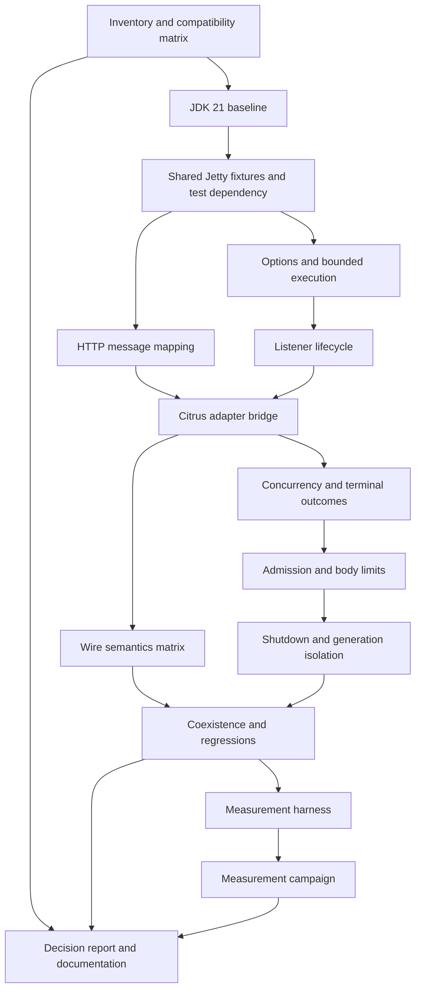

# Tasks: Evaluate Vert.x for the Citrus HTTP server

## Status and execution boundary

**Stage 03, 2026-10-13.** Implements the plan for Approach C from
[Stage 02](02-architecture.md), covering AC1–AC10 in [Stage 01](01-specification.md).
Stages 01 and 02 were updated and their gates rechecked before this breakdown.

This document records the agreed task plan. Implementation was subsequently attempted and
audited on 2026-10-14. The user has authorized corrections from that audit; current task status
and verification evidence are recorded in [Stage 04](04-implementation.md). The unchecked
items below remain the verification requirements, not a claim that no implementation exists.
During execution, stop at an actual blocker and preserve the evidence. Do not bypass a missing
prerequisite, change the dependency baseline, or expand into a production migration.

Use **JDK 21 only** for Maven, test forks, clients and measurement child processes. Keep the
root POM's Java 17 source/release target unchanged and use only APIs permitted by that target.
Record the precise JDK vendor/build. This evaluation establishes no JDK 17 runtime result.

Documents remain local under the repository's existing `docs/` exclusion. The capability delta
is `none`: this is test-only evaluation tooling, with no production capability archive to apply.

## Dependency graph



The graph describes dependencies, not an instruction to delegate work. Each task is intended
to fit within one focused workday; split a task and update this plan if implementation evidence
shows otherwise. No task becomes complete merely because its candidate fails: it must produce
the specified evidence, and dependent success claims must be withheld.

## Paths and verification conventions

These aliases identify actual repository directories. New filenames listed under them are
proposed test support; no new production package is planned.

| Alias | Repository-relative directory |
|---|---|
| `P` | `endpoints/citrus-http/src/test/java/org/citrusframework/http/prototype/` (create) |
| `I` | `endpoints/citrus-http/src/test/java/org/citrusframework/http/integration/` (existing) |
| `R` | `endpoints/citrus-http/src/test/resources/org/citrusframework/http/prototype/` (create) |
| `E` | `endpoints/citrus-http/target/vertx-evaluation/` (generated evidence) |
| `D` | `docs/http-server-vertx-evaluation/sdd/` (local documents) |

All shell commands run from the repository root with JDK 21 selected. Before each execution
session, verify `java -version` and `./mvnw -version` both report 21. Test support also records
its runtime version; measurement children use the current runtime's Java executable explicitly.
Do not override `-Djava.version`, which would change the compiler target.

The following command forms apply to each task's named test classes:

```sh
# Unit verification; replace CLASS with the exact class listed in the task.
./mvnw test -pl endpoints/citrus-http -am -Dtest=CLASS -Dsurefire.failIfNoSpecifiedTests=false

# Socket/integration verification; replace CLASS with the exact class listed in the task.
./mvnw verify -pl endpoints/citrus-http -am -Dit.test=CLASS -Dfailsafe.failIfNoSpecifiedTests=false

# Full selected regression set, initially the modules below; extend using T1's inventory.
./mvnw verify -pl endpoints/citrus-http,endpoints/citrus-websocket,endpoints/citrus-ws,connectors/citrus-openapi,tools/cucumber-steps/citrus-cucumber-http -am
```

Below, `U(Class)` and `I(Class)` mean these exact unit/integration commands with `CLASS`
substituted. The no-match flags only accommodate upstream reactor modules. For every named
class, inspect the current run's Surefire/Failsafe XML: a nonzero expected case count and no
unexpected failure, error or skip are required. Delete or segregate stale reports before a run;
an old green report or a zero-test build is not evidence. Expected negative cases assert the
failure explicitly and must themselves pass. Do not set blanket skip flags.

For every behavioral task, first write a failing test for the intended observable behavior,
record the failure, implement the minimum test-support code, and rerun it. Use existing TestNG
conventions and Apache license headers. Update `D/04-implementation.md` during future execution
with commands, runtime, results, deviations and blockers; do not create it during Stage 03.

## Task list

### T1: Complete the dependency and configuration inventory

- **Complexity:** Medium.
- **Files:** inspect HTTP, WebSocket, SOAP, Kubernetes/Knative, OpenAPI, Selenium, catalog and
  Cucumber source/resources/POMs; create the inventory and compatibility tables in
  `D/04-implementation.md` during execution. No production files modified.
- **Depends on:** none.
- **Covers:** AC1, AC2, AC10.
- **Steps:**
  1. Reproduce the Stage 02 searches for Jetty imports/dependencies, HTTP subclasses, concrete
     `HttpServer` consumers, and configuration references across source and resources.
  2. Account for every production hit, separating signatures, runtime use, dependency-only,
     generated and test-only coupling. Inventory all HTTP builder/annotation/XML options and
     their XML/YAML/Groovy exposure, including security, reporting and conversion.
  3. Classify each option as reusable, translated, retained on Jetty or breaking. Add ordinary
     HTTP, TLS and custom Servlet examples; identify external prerequisites for affected tests.
- **Verification:**
  - [ ] Run `rg -n 'org\.eclipse\.jetty|extends HttpServer|org\.citrusframework\.http\.server\.HttpServer' --glob '*.java'` and `rg -n 'jetty|<artifactId>citrus-http</artifactId>|vertx.version' --glob 'pom.xml'`; reconcile every production hit with the table.
  - [ ] Compare configuration rows against `AbstractHttpServerBuilder`, `HttpServerConfig`,
    parsers, schemas and registrations; no discovered option is silently omitted.
  - [ ] Existing GraphQL planning is labeled as a future consumer, not an available module.

### T2: Capture the JDK 21 baseline and required test prerequisites

- **Complexity:** Low.
- **Files:** create `E/baseline/` reports and update `D/04-implementation.md`; no source edits.
- **Depends on:** T1.
- **Covers:** AC7, AC8, AC9.
- **Steps:**
  1. Establish an isolated feature checkout if needed, preserving the existing unrelated work.
     Record commit, checkout diff, JDK 21 vendor/build, Maven, OS/hardware and module selection.
  2. Run the selected regression command above before adding Vert.x. Record every expected
     suite's test counts and failures/skips, plus available external prerequisites from T1.
  3. Capture baseline dependencies and actual runtime JAR count/bytes, separated from test
     tooling. Preserve reports outside directories that later Maven clean runs remove.
- **Verification:**
  - [ ] `java -version` and `./mvnw -version` report JDK 21; test reports confirm the fork runtime.
  - [ ] The selected regression command has current reports, including `WebSocketEndpointIT`,
    `WebServiceServerJavaIT`, `OpenApiServerIT` and HTTP Cucumber `HttpFeature_IT`.
  - [ ] `./mvnw dependency:tree -pl endpoints/citrus-http -Dscope=test` is captured with version
    mediation visible. Unavailable mandatory prerequisites or unexplained baseline failures
    stop execution before prototype edits; they are not labeled prototype regressions.

### T3: Establish shared Jetty fixtures and the test-only Vert.x dependency

- **Complexity:** Medium.
- **Files:** modify `endpoints/citrus-http/pom.xml` in test dependencies only; create
  `P/HttpServerContractFixtures.java`, `I/JettyHttpServerContractIT.java`, `R/` payload fixtures.
- **Depends on:** T2.
- **Covers:** AC3, AC4, AC9.
- **Steps:**
  1. Create real-socket fixtures using ephemeral ports, finite deadlines and guaranteed cleanup.
     Run them against current Jetty with existing Citrus receive/send actions.
  2. Include reproducible text/charset/binary payloads and status/header/query expectations;
     record a deliberate expectation mismatch as an asserted Citrus failure.
  3. Add managed `io.vertx:vertx-core` with test scope. Add no new module, runtime dependency,
     BOM entry, engine registration or test framework.
- **Verification:**
  - [ ] `I(JettyHttpServerContractIT)` passes with all initial fixtures represented.
  - [ ] Dependency-tree comparison shows only the intended test dependency additions/mediation;
    the production HTTP API/configuration and root-managed versions are unchanged.

### T4: Implement request and response mapping in test support

- **Complexity:** Medium.
- **Files:** create `P/VertxHttpMessageMapper.java`, `P/VertxHttpMessageMapperTest.java`; extend
  `P/HttpServerContractFixtures.java` and `R/` as needed.
- **Depends on:** T3.
- **Covers:** AC3, AC4.
- **Steps:**
  1. Write mapping tests for method, protocol, context/path/query metadata and header conversion,
     including duplicate/valueless/encoded query parameters and internal-header exclusion.
  2. Reuse the existing Citrus entity/header converter where appropriate; provide explicit wire
     conversion for UTF-8, declared non-UTF-8, empty and configured binary bodies.
  3. Map explicit/missing status and null replies; define HEAD suppression and transport-owned
     framing. Keep unimplemented cookie/form/gzip/Servlet cases visible in T1's matrix.
- **Verification:**
  - [ ] `U(VertxHttpMessageMapperTest)` passes on the fixture matrix.
  - [ ] `U(HttpMessageConverterTest)` and `U(DelegatingHttpEntityMessageConverterTest)` still pass.
  - [ ] Binary and charset assertions compare actual bytes, not only string representations.

### T5: Define immutable options and bounded worker ownership

- **Complexity:** Medium.
- **Files:** create `P/VertxHttpServerPrototypeOptions.java`, `P/PrototypeExchangeExecutor.java`,
  `P/VertxHttpServerPrototypeOptionsTest.java`, `P/PrototypeExchangeExecutorTest.java`.
- **Depends on:** T3.
- **Covers:** AC5, AC6.
- **Steps:**
  1. Test option validation and the Stage 02 defaults: loopback/port zero, status 200, finite
     deadlines, eight workers, 32 total exchanges and a 1 MiB body limit.
  2. Implement an endpoint-owned bounded executor and exchange permit ownership. Construction
     starts no listener; no static shared worker pool or borrowed Vert.x instance is introduced.
  3. Test admission, rejection, exception propagation and exactly-once release, including a
     terminal transport with worker activity still running. Disallow option mutation while running.
- **Verification:**
  - [ ] `U(VertxHttpServerPrototypeOptionsTest)` and `U(PrototypeExchangeExecutorTest)` pass.
  - [ ] A blocked worker cannot cause unbounded queued work or early permit reuse; invalid
    options fail before resource allocation.

### T6: Implement basic listener lifecycle and failed-start cleanup

- **Complexity:** Medium.
- **Files:** create `P/VertxHttpServerPrototype.java` and `I/VertxHttpServerLifecycleIT.java`;
  reuse T5 options/executor. No core lifecycle changes.
- **Depends on:** T5.
- **Covers:** AC6.
- **Steps:**
  1. Start with failing lifecycle tests: no socket on construction, actual bound port available
     after start, repeated start/stop, and port reuse after stop.
  2. Extend `AbstractServer`; own a non-clustered Vert.x instance per endpoint. Wait for bind
     and close completion off the event loop, with bounded synchronous lifecycle entry points.
  3. Cover occupied-port failure, partial initialization cleanup and late bind after startup
     timeout; make cleanup safe through both stop and destroy.
- **Verification:**
  - [ ] `I(VertxHttpServerLifecycleIT)` passes and checks socket/resource state, not only flags.
  - [ ] A failed start leaves no listener or owned executor/event-loop resource alive.

### T7: Connect the listener to Citrus receive and reply actions

- **Complexity:** Medium.
- **Files:** modify `P/VertxHttpServerPrototype.java`; create
  `I/VertxHttpServerRoundTripIT.java` and `I/VertxHttpServerReplyIT.java`.
- **Depends on:** T4, T6.
- **Covers:** AC3, AC4, AC5.
- **Steps:**
  1. Write failing GET/POST socket tests where existing HTTP actions receive the request and
     supply a chosen reply, using the generic `Endpoint` overload.
  2. Initialize the normal default adapter/queues, delegate producer/consumer access, snapshot
     request data, run the blocking adapter on the owned executor, and write on the Vert.x context.
  3. Test explicit/default status, null reply, default-adapter reply timeout and configured
     fallback. Assert timeout follows existing empty/default-status behavior rather than 504.
  4. Assert the adapter thread is not an event-loop thread and a deliberate Citrus mismatch fails.
- **Verification:**
  - [ ] `I(VertxHttpServerRoundTripIT)` and `I(VertxHttpServerReplyIT)` pass.
  - [ ] Both success and expected-failure cases prove that Citrus controls the response; a
    static echo callback alone cannot satisfy this task.

### T8: Complete the shared HTTP wire-semantics matrix

- **Complexity:** Medium.
- **Files:** create `I/VertxHttpServerContractIT.java`; modify shared fixtures, Jetty contract
  tests, mapper and prototype only as required by failing cases.
- **Depends on:** T7.
- **Covers:** AC3, AC4.
- **Steps:**
  1. Apply identical fixtures to both engines for GET, POST, PUT, PATCH, DELETE, OPTIONS and
     HEAD; exercise TRACE separately and record any restriction.
  2. Compare method, headers, paths/context/query, charset, empty and binary bodies, response
     status/headers and wire framing. Prove HEAD suppression on the wire.
  3. Record every difference by scenario. For cookies, gzip, forms/multipart, matrix-path
     policy, Servlet attributes and custom converters, retain explicit support/gap classifications.
- **Verification:**
  - [ ] `I(JettyHttpServerContractIT)` and `I(VertxHttpServerContractIT)` pass the supported subset.
  - [ ] Every required fixture has an engine-specific recorded outcome; excluded capabilities
    cannot appear as passed or silently disappear from the compatibility matrix.

### T9: Verify concurrent exchanges, failures and late completions

- **Complexity:** Medium.
- **Files:** create `P/PrototypeExchange.java` and `I/VertxHttpServerConcurrencyIT.java`;
  modify prototype and executor.
- **Depends on:** T7.
- **Covers:** AC5.
- **Steps:**
  1. Hold two requests with barriers and reply to the second first using separate test contexts
     or explicit existing correlation. Prove independent progress with separate client connections.
  2. Track exchange/generation identity and a terminal-state guard while preserving Citrus
     temporary reply queues. Test same-context correlation hazards explicitly in fixture design.
  3. Exercise adapter exceptions, disconnects and late replies. Capture failures for the test
     harness, return 500 when writable, and prevent duplicate or cross-request writes.
- **Verification:**
  - [ ] `I(VertxHttpServerConcurrencyIT)` passes reverse-order, thread-safety and terminal-race cases.
  - [ ] Adapter exceptions produce an asserted harness failure record; receiving 500 alone
    does not count as successful Citrus execution.

### T10: Enforce request admission, body limits and read deadlines

- **Complexity:** Medium.
- **Files:** create `I/VertxHttpServerLimitsIT.java`; modify prototype, exchange and executor.
- **Depends on:** T9.
- **Covers:** AC5 and Stage 01 resource-limit constraints.
- **Steps:**
  1. Add failing tests for a body larger than 1 MiB, including chunked transfer without a known
     length, slow/incomplete bodies, and 32 admitted requests plus one excess request.
  2. Reject oversized bodies with 413 and full admission with 503 before dispatch/buffering
     unbounded work. Apply the finite body-read deadline and record its wire outcome.
  3. Exercise every permit-release path, including disconnected clients whose worker remains
     active. Keep those permits occupied until both transport and worker activity terminate.
- **Verification:**
  - [ ] `I(VertxHttpServerLimitsIT)` passes; rejected requests never invoke the adapter.
  - [ ] After each rejection/timeout scenario, a new allowed request completes and resource
    accounting returns to zero. Record differences from Jetty as experiment policies.

### T11: Complete shutdown, restart and generation-isolation scenarios

- **Complexity:** Medium.
- **Files:** extend `I/VertxHttpServerLifecycleIT.java`; create
  `I/VertxHttpServerShutdownIT.java`; modify prototype/exchange/executor as tests require.
- **Depends on:** T10.
- **Covers:** AC5, AC6.
- **Steps:**
  1. Test stop during pending reads/replies, completion racing shutdown, repeated stop and
     destruction after stop. Assert actual close and worker termination within the 10-second budget.
  2. Run three complete start/stop generations with fresh default queues/adapters. Prove old
     replies cannot write to a new request, and no old queued request satisfies a new receive.
  3. Never purge externally owned queues. Document restart limitations for custom adapters.
     Test a deadline-violating adapter in a bounded child process so the test JVM cannot hang;
     forced child termination is recorded as a failed cleanup experiment, not success.
- **Verification:**
  - [ ] `I(VertxHttpServerLifecycleIT)` and `I(VertxHttpServerShutdownIT)` pass supported cases.
  - [ ] Port reuse and owned-thread termination are observed after each generation; expected
    deadline failures retain diagnostics and cannot be hidden by daemonizing leaked workers.

### T12: Demonstrate coexistence and run affected regression suites

- **Complexity:** Medium.
- **Files:** create `I/HttpServerEngineCoexistenceIT.java`; generate `E/regression/` evidence;
  update the implementation record. Existing production/tests are not rewritten to obtain a pass.
- **Depends on:** T8, T11; uses T1 inventory and T2 baseline.
- **Covers:** AC7, AC9.
- **Steps:**
  1. Start Jetty and Vert.x HTTP endpoints together on distinct ports. Exchange different
     payloads and stop/recreate one while the other continues; check isolation and linkage.
  2. Run the full selected regression command and the additional required consumers from T1.
     Keep SOAP/WebSocket on Jetty; include HTTP TLS/basic-auth and parser/DSL regressions.
  3. Compare reports/dependency graphs with T2; confirm production exports, schemas, endpoint
     registrations, root-managed versions and compiler settings remain unchanged.
- **Verification:**
  - [ ] `I(HttpServerEngineCoexistenceIT)` and the selected regression command pass.
  - [ ] Current reports account for expected executed/failed/skipped cases. A missing mandatory
    external service is a blocker, not a skipped passing verification.
  - [ ] `git diff --check` passes and the feature diff is limited to test support, test resources
    and the test-scoped dependency (local planning docs stay excluded).

### T13: Build the reproducible fresh-process measurement harness

- **Complexity:** Medium.
- **Files:** create `P/HttpServerMeasurementHarness.java`, `P/HttpServerMeasurementProcess.java`,
  `P/HttpServerMeasurementHarnessTest.java`; reuse fixtures and generate `E/measurements/`.
- **Depends on:** T12.
- **Covers:** AC8.
- **Steps:**
  1. Provide a test-only command entry point selecting `jetty` or `vertx`. Launch every measured
     server in a fresh child JVM using the exact parent JDK 21 executable; record classpath and JVM flags.
     Assemble the child classpath from the actual test-runtime classloader or a Maven-resolved
     manifest; `java.class.path` alone under `exec:java` need not contain the test dependencies.
  2. Separate process start-to-listen and server start-to-listen. Record thread counts, named
     memory method/timing, raw request samples, p50/p95 latency and failures for fixed text/binary fixtures.
  3. Use eight clients, 100 warmup requests and 1,000 measured requests per fixture. Include
     adapter/worker cost and bound all child-process lifetimes; preserve raw data before aggregation.
  4. Add focused tests for deadline/child-failure propagation and statistics over known samples.
     Keep test-tooling dependencies distinct from engine/runtime inventory; do not strip required Jetty JARs.
- **Verification:**
  - [ ] `U(HttpServerMeasurementHarnessTest)` passes meaningful aggregation and failure cases.
  - [ ] A single diagnostic run per engine emits the documented measurements and child JDK 21
    identity, exits cleanly, and does not count as the completed five-run comparison.

### T14: Execute and analyze the measurement campaign

- **Complexity:** Low.
- **Files:** generate `E/measurements/` raw samples/summary; update `D/04-implementation.md`.
- **Depends on:** T13.
- **Covers:** AC8.
- **Steps:**
  1. Run at least five fresh measured processes per engine with identical fixtures and settings;
     alternate engine order and record machine load and any explicit budget override.
  2. Report raw samples, per-run p50/p95 latency, median/range across runs, startup, threads,
     memory proxy and JAR count/bytes. Separate runtime/test tooling and additive prototype graphs.
  3. Label any hypothetical Jetty-free packaging as a model. Draw no production performance
     conclusion from differing workloads, omitted resources or failed/incomplete runs.
- **Verification:**
  - [ ] After installing the selected reactor artifacts with `./mvnw install -pl endpoints/citrus-http -am`, run the proposed harness through the existing managed exec plugin:

    ```sh
    ./mvnw exec:java -pl endpoints/citrus-http -Dexec.classpathScope=test -Dexec.mainClass=org.citrusframework.http.prototype.HttpServerMeasurementHarness -Dexec.args="--engines jetty,vertx --runs 5 --concurrency 8 --warmup 100 --requests 1000"
    ```

  - [ ] The harness contract from T13 accepts these arguments, runs from the module's absolute
    target/evidence path regardless of working directory, and records at least five valid fresh
    JDK 21 processes per engine with both payload fixtures. Invalid runs remain visible.
  - [ ] Recomputed summaries match the retained raw samples; no unmeasured compatibility or
    footprint claim appears in the conclusions.

### T15: Deliver the compatibility decision and usage documentation

- **Complexity:** Medium.
- **Files:** finalize `D/04-implementation.md`; create `D/05-documentation.md`; refine
  `D/01-specification.md`, `D/02-architecture.md` and this task record only if evidence warrants it.
- **Depends on:** T1, T12, T14.
- **Covers:** AC1, AC2, AC9, AC10; reconciles evidence for all criteria.
- **Steps:**
  1. Consolidate inventory, configuration classifications, result matrix, raw-report locations,
     limitations, reproducible JDK 21 commands and ordinary HTTP/TLS/custom-Servlet examples.
  2. Compare retain-Jetty, optional-engine and replacement outcomes using actual evidence.
     Address other consumers, same-JVM coexistence, user configurations, #1807 reuse and SOAP's
     independent transport. Distinguish source/binary/configuration/dependency compatibility.
  3. Document how to construct/run the test prototype, its supported subset, deadlines/limits,
     failure records and cleanup. Do not add it to the production user guide as a shipped endpoint.
  4. Close task/AC evidence only where justified. The `none` capability delta needs validation
     but no baseline creation or archive application. Keep a production proposal separate.
- **Verification:**
  - [ ] Every AC has linked evidence and a supported conclusion; no `BLOCKED`/unrun case is
    represented as passed, and a remaining blocker is reported instead of declaring completion.
  - [ ] `python3 /Users/asuruceanu/.codex/skills/sdd-workflow/scripts/capspec.py validate docs/http-server-vertx-evaluation/sdd` reports zero errors.
  - [ ] Documentation commands agree with the implemented harness; links, defaults, test counts
    and JDK restriction agree across all stage documents. Retain already-current passing checks;
    rerun affected checks only if final edits alter executable behavior.

## Acceptance-criteria traceability

| Criterion | Tasks providing evidence |
|---|---|
| AC1 — Dependency/API inventory | T1, T15 |
| AC2 — Configuration compatibility | T1, T15 |
| AC3 — Citrus-controlled round trips | T3, T4, T7, T8 |
| AC4 — Payload/reply semantics | T3, T4, T7, T8 |
| AC5 — Concurrency/failure isolation | T5, T7, T9, T10, T11 |
| AC6 — Lifecycle | T5, T6, T11 |
| AC7 — Coexistence | T2, T12 |
| AC8 — Measurement | T2, T13, T14 |
| AC9 — Existing behavior | T2, T3, T12, T15 |
| AC10 — Reviewable conclusion | T1, T15 |

No ADDED/MODIFIED capability requirement IDs exist for this evaluation. Additional resource
constraints are explicitly covered by T5, T10 and T11.

## Execution strategy and stopping rules

1. **Foundation — T1–T3:** establish the inventory, JDK 21 baseline and shared fixtures. A
   baseline build, mandatory prerequisite or managed-dependency blocker stops the work here.
2. **Prototype — T4–T11:** implement test support with failing tests first. Preserve real negative
   feasibility results. If a required behavior needs changes outside test support, stop and report
   the precise limitation rather than silently introducing a production SPI or version upgrade.
3. **Evidence — T12–T14:** run coexistence/regressions before measuring. Failed correctness or
   cleanup checks prevent presenting a candidate as suitable or moving to a performance comparison.
4. **Decision — T15:** produce Stage 05 documentation when execution is complete. A negative
   feasibility result can support a retain-Jetty conclusion, but cannot satisfy unexecuted tasks.
   No capability archive applies to the explicit `none` delta.

The current turn ends after the Stage 03 planning gate. Stage 04 is not authorized by creation
of this document.

## Rollback plan

- **After foundation:** preserve local reports; revert only the feature's test dependency and
  fixtures if abandoning the experiment. Leave unrelated working-tree changes untouched.
- **After prototype:** remove the feature's prototype classes/tests/resources and test dependency
  as one coherent change. No production schema, stored data, runtime API or configuration migration
  exists. Stop owned listeners/processes before removing files.
- **After evidence/documentation:** retain raw results and local decision documents with their
  commit/runtime provenance, even if prototype code is discarded. Do not alter production defaults
  or rewrite historical results to make the evaluation look successful.

## Stage 3 quality gate

- [x] **Complete task list:** inventory, test support, regression coverage, measurements and
  documentation are included; no database/configuration migration applies.
- [x] **Dependencies:** the graph and task prerequisites give a valid execution order.
- [x] **Complexity:** every task has an estimate and a bounded purpose.
- [x] **Verification:** each task has concrete commands or inspectable evidence checks.
- [x] **Traceability:** AC1–AC10 and resource constraints are mapped; no capability IDs are omitted.
- [x] **Rollback:** each phase can be removed without changing production behavior or unrelated work.
- [x] **Document validation:** links, fences, whitespace, prerequisite ordering and AC1–AC10
  coverage passed on 2026-10-13; targeted capability validation returned zero errors and warnings.

**Result: Stage 03 planning gate passed.** All 15 execution tasks remain pending. Runtime
prerequisites and candidate feasibility will be verified during the planned work, not inferred
from this document check.

## Context-path and URL-mapping extension (14 October 2026)

Support one context path and one Citrus dispatch mapping per prototype endpoint. Preserve the
full request path/URI in Citrus headers and expose the configured context path separately.
Match context paths on segment boundaries; return 404 outside the selected context or mapping.
Support default/root (`/`, `/*`), exact (`/orders`), prefix (`/orders/*`), extension (`*.json`)
and context-root-only (empty string) patterns. A bare non-root context redirects to its trailing
slash with HTTP 301, retaining the query string, as observed against Jetty. Settings are captured at start.
This translates URL selection only; custom Servlet instances, filters, forwarding, dispatching
and multiple competing Servlet registrations remain outside scope. Keep default root routing
and production code unchanged. Run under JDK 21 with the Java 17 compiler target.

Tasks: write shared Jetty/prototype socket cases first; add validated route settings and
request dispatch; test restart snapshots and real Citrus context/path headers; run the full
HTTP module; update the comparison and usage example with verified limits.

## Basic authentication extension

Add optional, immutable Basic credentials for all matched prototype routes. Missing, malformed
or incorrect credentials receive 401 with a realm challenge before body buffering, admission
or Citrus adapter invocation. Credentials and realm are captured per startup. Keep authentication
disabled by default. Support printable ASCII credentials (username cannot contain a colon),
passwords containing colons, and case-insensitive scheme names. Reject duplicate Authorization
headers. Scope excludes roles, external login services, per-path policies and TLS.

Use a small immutable credential checker in the existing request handler. This avoids adding
Vert.x Web/Auth dependencies; reusing Jetty security handlers would retain the Servlet dependency.
Verify shared Jetty/prototype socket cases first (red), then parser/configuration edge cases,
restart snapshots, incomplete unauthorized uploads and real Citrus actions. Run the complete HTTP
module on JDK 21 and update the comparison with the precise support boundary.

## Form and multipart conversion extension

Add URL-encoded form reading to a Citrus MultiValueMap and form/multipart writing from a
MultiValueMap. Reuse Spring FormHttpMessageConverter, already on the classpath, rather than
hand-written escaping/MIME boundary logic or a new multipart dependency. Preserve repeated
fields, empty/valueless fields, explicit charsets, filenames, part headers and binary bytes.
Keep inbound multipart as a raw Citrus message, matching the current upload API; no Servlet
Part objects or upload-to-disk API. Configured binary media types retain raw bytes.

Write shared Jetty/prototype socket tests first, then conversion edge cases and real Citrus
receive/send tests. Retain authentication/body-size/timeout checks before conversion and preserve
500 reporting for invalid outbound conversion. Run the clean HTTP module on JDK 21. Document
any parameterized media-type differences instead of asserting complete Spring MVC equivalence.

## Response tracing cache extension

Add a bounded response tracing cache to each prototype generation. This stores converted
response plans keyed by exchange ID; it never serves later requests from the cache. Reuse the
Citrus response-cache-size setting as the default, capture capacity at start, support zero as
disabled, and reject negative capacity. Retain at most N entries, evict oldest insertions, and
return defensive snapshots. Close and clear the cache on stop; late old-generation work cannot
repopulate it. Cache admitted exchanges when their response is submitted, not as proof of delivery.
Route/authentication/admission rejections have no exchange and remain outside this cache.

Choose a synchronized bounded LinkedHashMap with immutable stored snapshots over separate
concurrent map/queue structures, to keep insertion, eviction and shutdown atomic. Do not reuse
Servlet request keys or implement Servlet interceptors. Verify the missing behavior first via
HTTP tests, then immutability, concurrency, capacity boundaries, shutdown and real Citrus actions.
Run the complete HTTP module on JDK 21 and document the cache's purpose and integration limits.

## Custom message-body converter extension

Register ordered Spring HttpMessageConverter instances with explicit inbound payload types.
Capture registrations at startup; use first matching canRead/canWrite converter before default
body conversion. Retain the existing Citrus HttpMessageConverter around the body conversion.
Execute converters on exchange workers, copy the registration list, preserve custom headers,
recompute response framing and retain HEAD/error semantics. Converter instances are caller-owned
and must be thread-safe; no Servlet context, MVC advice or controller argument resolution is added.

Prefer a small typed registration/stream adapter using Spring APIs already present over a new
Servlet dependency or a proprietary serializer API. First reproduce the missing conversion with
HTTP tests, then test ordering, typed conversion, errors, lifecycle snapshots, default fallback
and real Citrus actions. Run the complete HTTP module on JDK 21 and document the exact boundary.

## Gzip extension

Automatically decode gzip requests before body conversion and encode eligible replies when
Accept-Encoding permits gzip. Run compression on exchange workers using JDK gzip streams rather
than adding a dependency or enabling unbounded automatic Netty decompression. Enforce the existing
body-size limit on compressed input and expanded bytes. Reject corrupt gzip with 400, expanded
oversize with 413 and unsupported/stacked request codings with 415. Preserve original request
headers for Citrus tracing. Honor gzip q=0, merge Vary, recompute framing, and avoid double encoding,
HEAD, empty/no-body responses and range responses. Trace cache stores final compressed reply bytes.

Verify shared Jetty/prototype gzip text and binary HTTP cases first, then malformed input,
expansion limits, negotiation and a real Citrus receive/send exchange. Document differences from
the Servlet filter's substring-based encoding selection. Run the clean HTTP module on JDK 21.


## Parsed multipart uploads

1. Add a failing converter test for repeated fields, empty files, headers and binary preservation.
2. Implement bounded parsing and immutable upload/part values using the existing Spring reader.
3. Verify malformed/truncated input, part/header/byte limits, charset handling and defensive copies.
4. Exercise parsing through real HTTP and Citrus receive/send actions; retain raw multipart tests.
5. Run the clean HTTP module under JDK 21 and document supported behavior and limits.


## Equivalent handlers and filters

1. Reproduce missing filter order, short-circuit, first-handler and continuation guarantees.
2. Implement the pipeline and snapshot it with the server generation.
3. Test HTTP hooks, worker execution, failures, restart snapshots and authentication ordering.
4. Verify real Citrus receive/send requests and replies pass through filters.
5. Run the clean JDK 21 HTTP build and update the comparison and usage documentation.


## HTTPS/TLS

1. Reproduce the lack of HTTPS with real trusted TLS 1.2/1.3 connections.
2. Wire immutable TLS options into startup with existing cleanup and lifecycle ownership.
3. Verify handshake failures, mTLS, protocol restriction, invalid stores and restart behavior.
4. Exercise a real Citrus receive/send exchange over HTTPS.
5. Run clean HTTP tests under JDK 21 and update usage and feature comparison accurately.


## Roles, login services and path policies

1. Reproduce missing role, method, path, default-deny and credential-validation behavior.
2. Implement immutable security configuration, service callback and authorization decisions.
3. Integrate before conversion on owned workers; preserve status/challenge and trusted metadata.
4. Verify HTTP denial, callback failures, worker execution, restart snapshots and downstream isolation.
5. Exercise real Citrus actions over HTTPS, run clean JDK 21 tests and update usage/comparison.

## WebSocket server extension

1. Add failing wire tests for text/binary, fragmentation, broadcast/targeted replies, limits and restart.
2. Implement the endpoint and authenticated upgrade lifecycle.
3. Verify WSS, denied upgrades and real Citrus actions; run clean HTTP and existing WebSocket regressions under JDK 21.
4. Update the maintainer comparison and usage documentation with the verified scope.

## SOAP server extension

1. Add failing SOAP bridge tests and test-only reactor fixture wiring.
2. Implement the generic HTTP exchange hook and native SOAP bridge with secure parsing and fault serialization.
3. Add wire and real Citrus SOAP action tests, including malformed input, SOAP versions, TLS and reply correlation.
4. Run clean HTTP and SOAP module verification under JDK 21 and update the maintainer report and usage docs.
